# Bitcoin Tracker

[](https://github.com/nelsongomezsa/bitcoin-tracker/actions/workflows/ci.yml)
[](LICENSE)

App web instalable (PWA) para apuntar a mano compras y ventas de bitcoin: precio medio, valor actual, ganancia o pérdida, ventas por FIFO, gráficas, calculadoras y avisos push. Cada usuario tiene su cuenta privada. Todo funciona en **planes gratuitos** (Firebase Spark + GitHub Actions), sin tarjeta.

**Demo en vivo:** https://bitcoin-tracker-4aac9.web.app (en la pantalla de entrada, el botón «Probar sin cuenta» carga una cartera inventada).

> **English summary.** Installable web app (PWA) to manually track bitcoin purchases and sales: average price, current value, profit or loss, FIFO realised gains, charts, calculators and push alerts. Private account per user, Firestore security rules, free tiers only (Firebase Spark + GitHub Actions). Alerts are information, not investment advice.

### Por qué existe

Durante meses vi a alguien de mi entorno llevar sus compras de bitcoin en un Excel: precio medio a mano, fórmulas que se rompían y ninguna forma rápida de saber cuánto iba ganando. Bitcoin Tracker nace para sustituir ese Excel por una app sencilla en el móvil: apuntas la compra y ves al momento tu precio medio, tu ganancia y cuándo vuelves a beneficios. Se puede importar el Excel de siempre y exportar los datos en cualquier momento.

## Novedades

Lo más reciente primero. El detalle completo está en el [CHANGELOG](CHANGELOG.md).

### 23 de noviembre de 2026
- **Gráfico pro con todas las temporalidades.** 1D y 1S salían vacíos porque el servidor solo refrescaba esas velas en una franja horaria que casi nunca coincidía con sus ejecuciones. Ahora las refresca según su antigüedad, con pausas entre peticiones a Kraken; y mientras falte alguna temporalidad, la app la pide directamente a Kraken en lugar de dejar el gráfico vacío.
- **Gráfico pro más limpio.** Las marcas que se solapan se agrupan en un marcador con el número, «Mis trades» va oculto por defecto en 1D y 1S y la línea punteada entrada-salida solo aparece para el trade seleccionado. Máx., Mín. y Vol. de 24 h se rellenan con el ticker de Kraken (también en la demo).
- **Pequeños arreglos.** Cada pantalla se abre arriba del todo; al cambiar a una temporalidad sin datos se limpia la escala de precios; y en Inicio, el minigráfico de «Valor actual» solo aparece si hay compras y dibuja la evolución real del valor por días (si no hay, no se pinta nada).
- **Sumar Trading a tu cartera, bien desglosado.** Con la opción «Sumar los BTC ganados con trades a mi cartera» (desactivada por defecto), Inicio muestra por separado «Cartera», «Trading (neto)» y «Total»; las pérdidas de Trading restan y el precio medio de tus compras no cambia.
- **Test intermitente del histograma arreglado.** Un precio justo en el límite entre dos intervalos podía caer a veces en el intervalo anterior; ahora siempre va al que empieza ahí, y los datos aleatorios de la auditoría usan una semilla fija para que sea reproducible.
- **Resultado en dinero en cada trade.** Apunta cuánto ganaste o perdiste en euros, dólares o dólares australianos (con signo menos si perdiste) y la app calcula los BTC con el precio de BTC de la vela de Kraken del cierre. Te enseña la cuenta antes de guardar, por ejemplo «−100 € → −0,00123001 BTC a 81.300 €/BTC», y puedes cambiar el precio o escribir los BTC a mano. Las pérdidas restan en el Total histórico, en «Por mes» y en Ganado, Perdido y Neto.
- **Margen destinado en cada trade.** Un campo opcional, junto a la nota, para recordar cómo montaste el trade (por ejemplo, «x10 con 0,15 BTC de margen»). Se ve en el detalle del trade y no cambia ningún cálculo.
- **Importar el Excel original.** La importación ignora sin fallar las celdas de error, las notas sueltas y las columnas vacías, y entiende «1. x5» en la columna Trade como el trade 1 con apalancamiento x5.
- **Corrección del gráfico de Inicio.** Con el precio en vivo, el gráfico se rehacía cada segundo y se veía rayado o «se volvía loco» al moverlo con el dedo. Ahora se crea una sola vez y solo se actualiza el último punto; además, en el móvil el scroll vertical mueve la página y el gráfico solo se desplaza en horizontal. «Abrir gráfico pro» abre siempre, y una cuenta nueva sin compras ve «Aún no has apuntado ninguna compra» con su botón y, debajo, el precio de BTC.
- **Trading.** Apunta trades largos y cortos y mira cuánto ganas. Aparece por defecto en la barra de abajo (se puede apagar en Ajustes). Cada trade enseña lo ganado, lo que vale hoy y el total acumulado tras él. El % y los BTC ganados se escriben a mano y mandan sobre el cálculo, que queda como sugerencia. Incluye la **«Media por trade»**, un resumen **«Por mes»**, gráficas y avisos de trades abiertos.
- **Importar desde Excel o CSV.** Comprueba fila a fila que el «Total histórico» cuadra con la suma de lo ganado en cada trade y avisa en la vista previa si alguna fila no cuadra.
- **Velas y precio en directo.** El Gráfico pro enseña velas de 1 y 5 minutos en directo y el precio de toda la app se actualiza en vivo mientras está abierta.
- **Vista simple o pro.** La vista pro, con tablas y un gráfico de velas tipo exchange, se activa en Ajustes o con el botón «PRO» de Inicio.
- **Hora opcional** en compras, ventas y trades.
- **Corrección:** las fechas día/mes/año de un CSV ya no se leen como fechas americanas.
- **Auditoría de cálculos.** Una calculadora de control independiente, tests con carteras aleatorias y una auditoría en el navegador (ahora, 374 comprobaciones sin diferencias) confirman que las cifras de la pantalla son las correctas.

### 22 de noviembre de 2026
- **Ballenas, empresas y gobiernos con BTC** y carteras públicas que se pueden seguir, en la pestaña Mercado.
- **Estadísticas ampliadas** de la cartera, de las compras y del mercado.
- **Avisos push** (y Telegram opcional): 36 avisos con horas de silencio, límite diario y prioridad.
- **Aviso de actualización:** cuando hay una versión nueva de la app, aparece «Hay una versión nueva · Actualizar».
- **Rediseño** de toda la app y formulario con plataforma y comisión en € o en %.
- Primera versión: compras y ventas, FIFO, plan, calculadoras, importar y exportar, modo demo y seguridad.

## Capturas (modo demo, datos inventados)

| Inicio | Estadísticas | Mercado | Ballenas | Añadir compra |
|---|---|---|---|---|
| 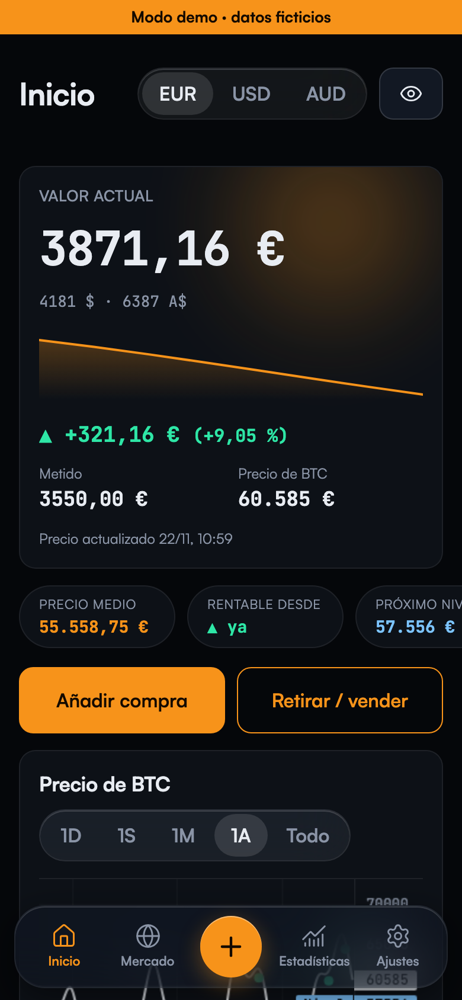 | 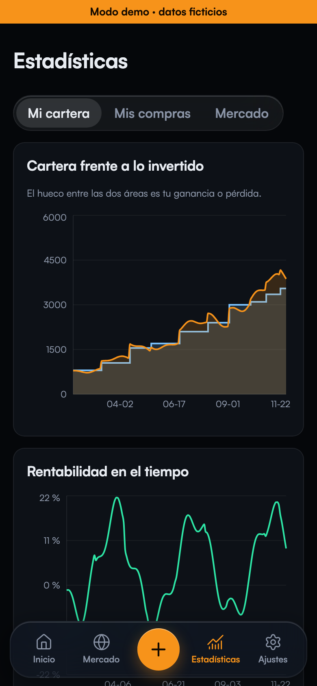 |  |  | 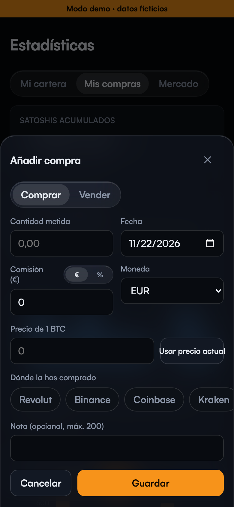 |

Trading y Gráfico pro:

| Resumen | Gráficas | Lista | Formulario | Gráfico pro |
|---|---|---|---|---|
| 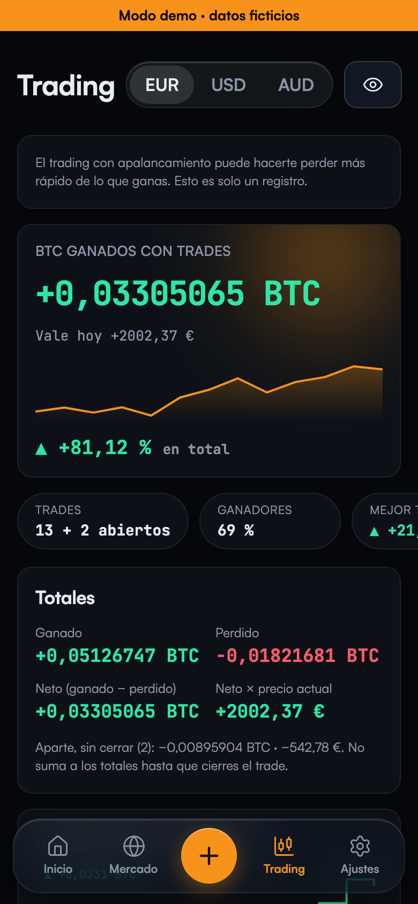 | 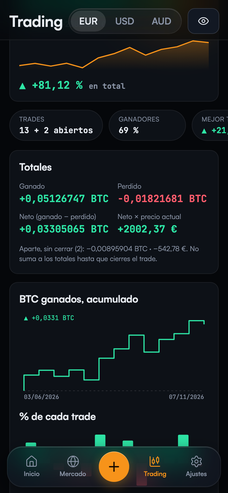 | 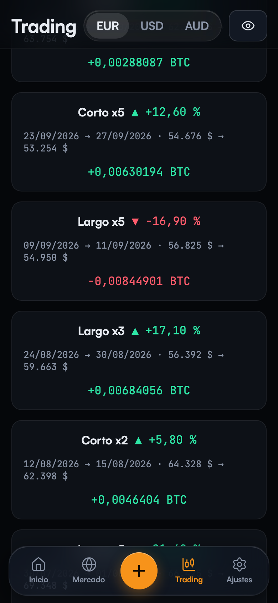 | 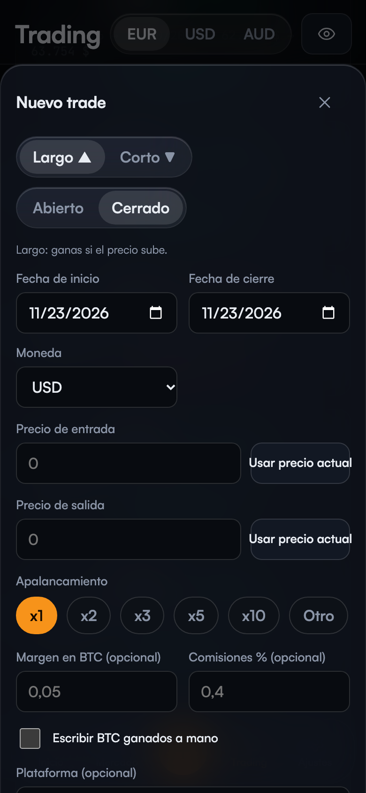 | 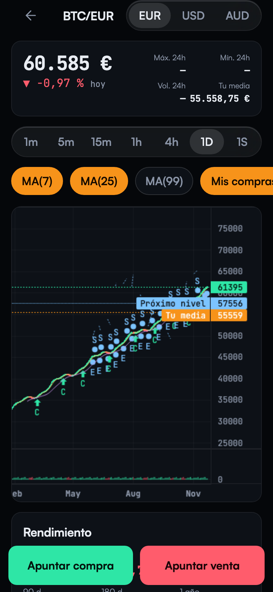 |

Vista simple y vista pro (Ajustes → Apariencia, o el atajo «PRO» de Inicio):

| | Inicio | Estadísticas | Mercado | Trading |
|---|---|---|---|---|
| Simple | 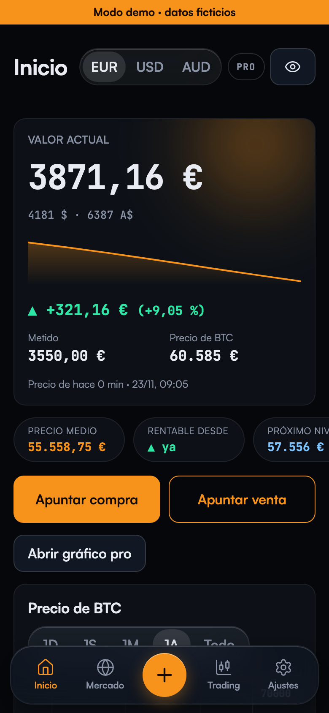 | 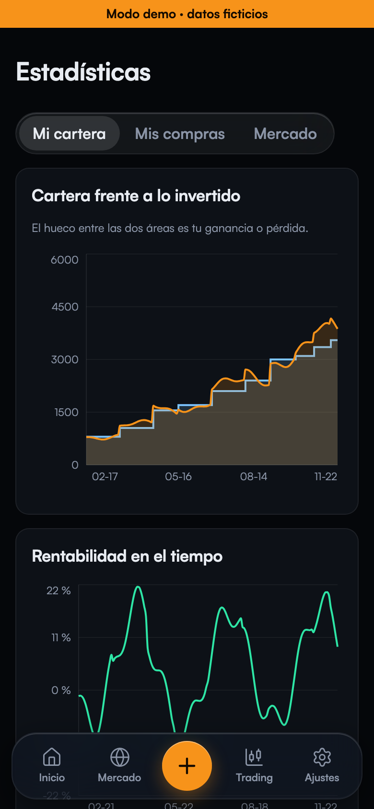 | 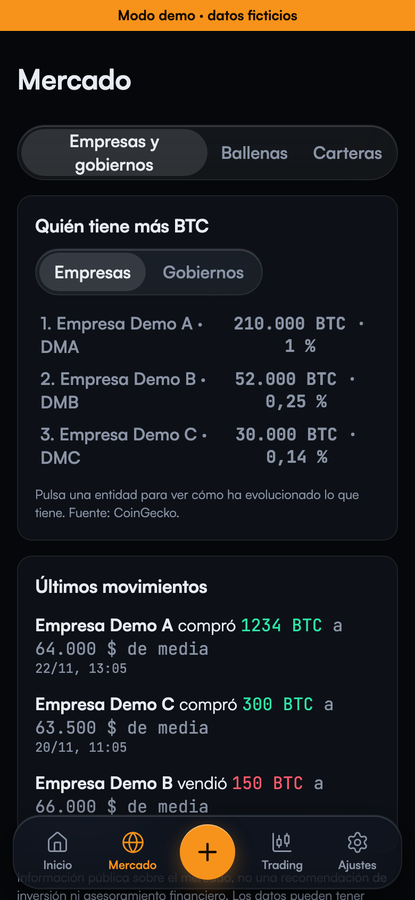 | 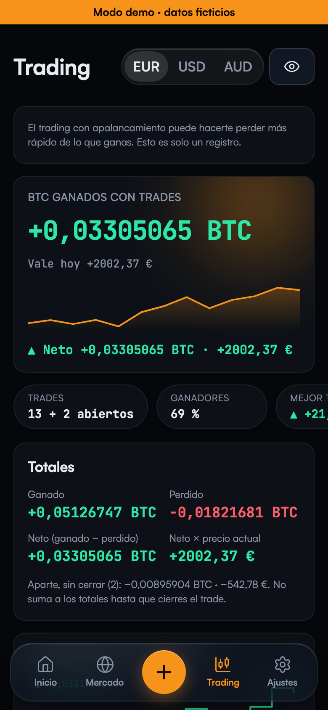 |
| Pro | 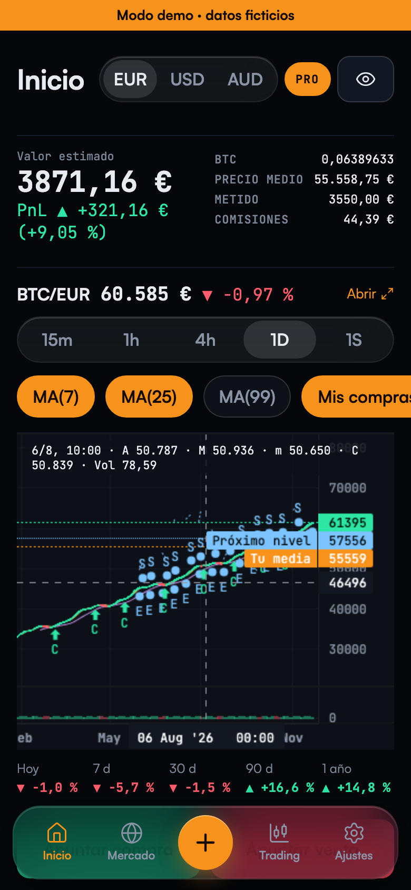 | 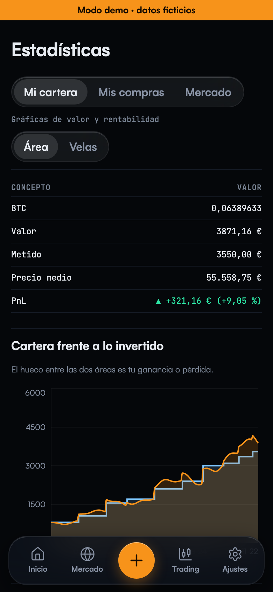 | 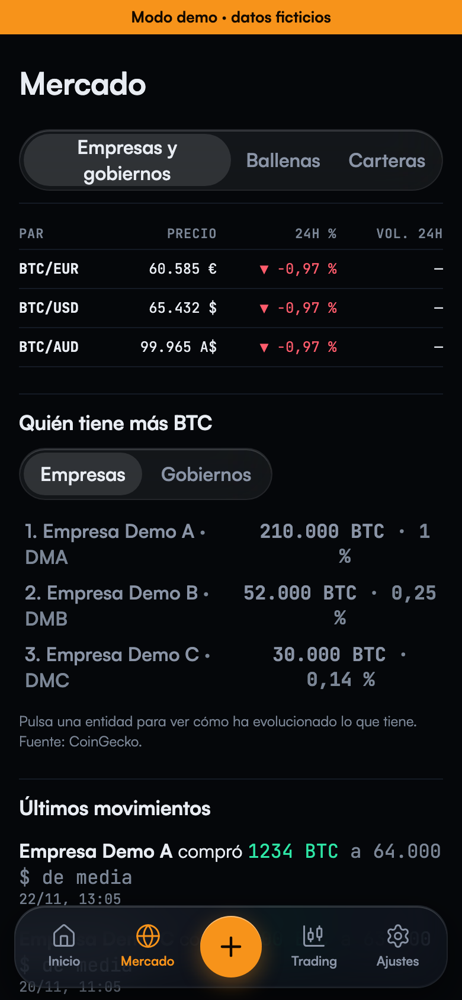 | 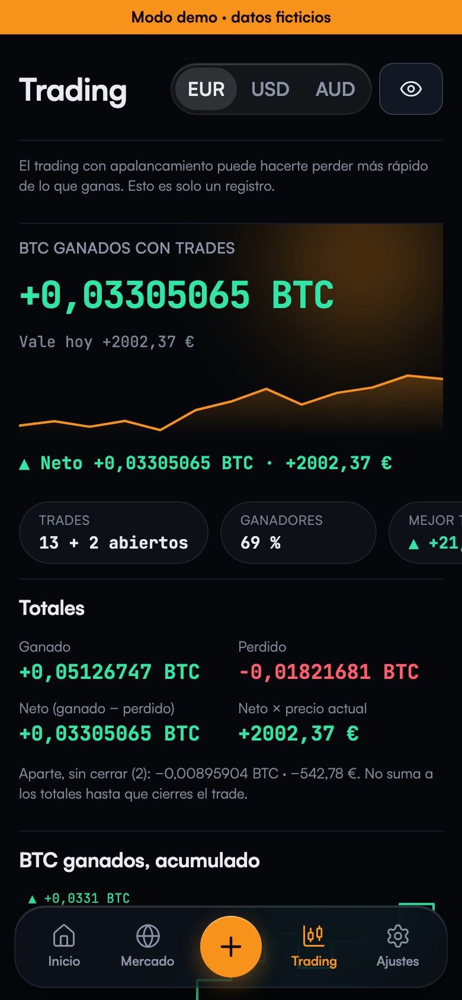 |

Escritorio: [Inicio](docs/capturas/inicio-escritorio.png) · [Mercado](docs/capturas/mercado-escritorio.png) · [Estadísticas](docs/capturas/estadisticas-escritorio.png) · [Ajustes](docs/capturas/ajustes-escritorio.png)

## Funciones

- Compras y ventas a mano con vista previa en directo (BTC recibidos, % de comisión, nuevo precio medio y resultado FIFO antes de confirmar).
- Precio medio con y sin comisiones, «rentable desde», ganancia por compra y aviso si la comisión supera el 3 %.
- Ventas por **FIFO** (criterio de Hacienda), ganancias realizadas, informe FIFO anual en CSV; no deja vender más de lo que tienes.
- Visualización en EUR / USD / AUD; cada operación conserva su propia moneda.
- Gráfica del precio (lightweight-charts) con una marca por compra o venta, línea de precio medio y próximo nivel clave.
- Estadísticas, plan con niveles clave y progreso de compra periódica (DCA) semanal, objetivos con precio de venta.
- Calculadoras: bajar mi precio medio, «¿y si BTC llega a X?» y «si vendo hoy» (con una estimación orientativa del impuesto del ahorro en España).
- **Avisos**: 36 en 7 grupos (movimientos de precio, máximos y mínimos, números redondos, vuelta a beneficios, hitos de ganancia, niveles clave, recordatorios de DCA, zonas de miedo y codicia, halving, resúmenes, ballenas, inicio de sesión en un dispositivo nuevo…), alertas de precio a medida, prioridad y canal por aviso, horas de silencio, límite diario, pausa, historial y envío por push o Telegram.
- **Pestaña Mercado**: empresas y gobiernos con BTC, movimientos de ballenas (≥ 500 BTC) y carteras públicas que puedes seguir. Estadísticas: velas, indicador de miedo y codicia, dominancia, ciclo del halving, comisiones de la red, caída desde máximos, mapa de precios de compra, calendario de DCA y comisiones por plataforma.
- **Trading** (se puede apagar en Ajustes → Apariencia): registro de entradas y salidas largas y cortas (el apalancamiento es opcional y por trade). El % y los BTC ganados de cada trade se escriben a mano y mandan sobre cualquier cálculo; el cálculo automático (movimiento × apalancamiento − comisiones, y margen × %) solo se ofrece como sugerencia en el formulario. Totales de ganado, perdido y neto (× precio actual), acumulado trade a trade, «Media por trade» (media simple de los %), racha, duración media, gráficas, importar/exportar Excel o CSV, informe fiscal anual y avisos de trades abiertos. La app **solo registra**: no opera ni se conecta a ningún exchange.
- **Gráfico pro** (estilo exchange, con el diseño de la app): velas de 1m a 1S con volumen, medias móviles, marcas de tus compras, ventas y trades, precio medio y próximo nivel, rendimiento por periodos y tu posición. El precio y las velas de 1m y 5m se actualizan en directo mientras la app está abierta.
- **Vista simple o pro** (opcional, simple por defecto): la vista pro es de estilo exchange, con cifras densas en monoespaciada, velas con volumen y medias móviles en Inicio, historial de operaciones en tabla, pestañas Operaciones · Trades · Plan · Avisos, tablas en Mercado y Trading, y gráficas de la cartera en área o en velas. Cambia solo la presentación: los datos y los cálculos son los mismos.
- Importar Excel/CSV con vista previa (en el propio navegador, máx. 2 MB, comprobación real del tipo de archivo) y exportar a CSV/XLSX.
- Bloqueo opcional con Face ID o huella (WebAuthn), modo privado, funciona sin conexión y modo demo.

## Arquitectura

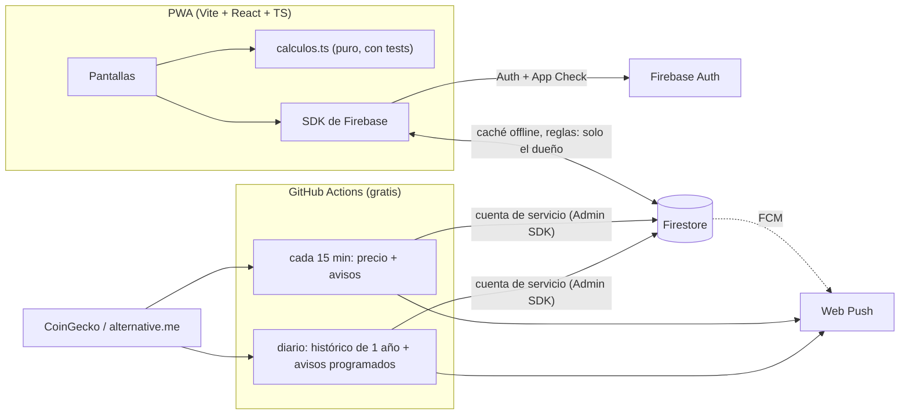

El navegador nunca llama a CoinGecko: las tareas programadas escriben `mercado/precio` y `mercado/historico`, y los clientes solo los leen (las reglas les impiden escribir). Para ahorrar lecturas del plan gratuito, el cliente deja un pequeño resumen (en EUR) en `users/{uid}/avisos/config`, así la tarea lee un documento por usuario en vez de todas sus operaciones.

## Stack, APIs y servicios de un vistazo

Un mapa rápido de todo lo que usa el proyecto, para quien quiera verlo o para reutilizarlo en futuros trabajos.

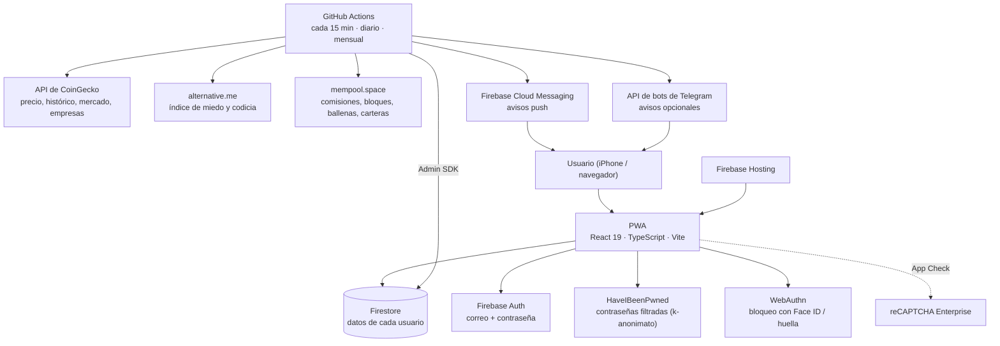

### APIs y servicios externos

| Servicio | Para qué se usa | Desde dónde se llama | Coste |
|---|---|---|---|
| **API de CoinGecko** (`/coins/markets`, `/coins/bitcoin/market_chart`, `/global`, tesorerías públicas) | Precio de BTC en EUR/USD/AUD, histórico de 1 año, dominancia, empresas y gobiernos con BTC | Solo desde las tareas de GitHub Actions (nunca el navegador) | Gratis (clave *Demo* gratuita opcional) |
| **Kraken, API pública** (`/0/public/OHLC`) | Velas de 15m, 1h, 4h, 1D y 1S (300 como mucho por temporalidad, en `mercado/velas_*`) | GitHub Actions; el navegador solo la usa para la carga inicial de las velas de 1m y 5m del Gráfico pro | Gratis, sin clave |
| **Kraken, WebSocket público** (`wss://ws.kraken.com/v2`, canales `ticker` y `ohlc`) | Precio en directo y vela en curso de 1m/5m, solo mientras la app está abierta y en primer plano (una sola conexión compartida) | Navegador (excepción explícita: son datos públicos de mercado, sin claves ni datos del usuario; no se guardan en Firestore) | Gratis, sin clave |
| **alternative.me** (`/fng`) | Índice de miedo y codicia | GitHub Actions | Gratis, sin clave |
| **mempool.space** (`/v1/fees/recommended`, `/blocks/tip/height`, `/address/…`) | Comisiones de la red, cuenta atrás del halving, movimientos de ballenas, carteras públicas | GitHub Actions | Gratis, sin clave |
| **Firebase Authentication** | Cuentas y verificación del correo | Navegador | Spark (gratis) |
| **Cloud Firestore** | Compras, ventas, objetivos y ajustes de avisos de cada usuario; datos de mercado compartidos | Navegador (reglas: solo el dueño) y tareas (Admin SDK) | Spark (gratis) |
| **Firebase Cloud Messaging** | Avisos push en iPhone y escritorio | Las tareas envían, el service worker recibe | Gratis |
| **Firebase Hosting** | Sirve la PWA con cabeceras de seguridad | — | Spark (gratis) |
| **Firebase App Check + reCAPTCHA Enterprise** | Bloquea peticiones que no vienen de la app real | Navegador | Nivel gratuito |
| **API de bots de Telegram** | Avisos opcionales a un chat de Telegram | GitHub Actions | Gratis |
| **HaveIBeenPwned (Pwned Passwords)** | Rechaza contraseñas filtradas al crear la cuenta; solo salen 5 caracteres del hash | Navegador | Gratis, sin clave |
| **GitHub Actions** | Tareas programadas (precio y avisos cada 15 min, histórico diario, mantenimiento mensual) y CI | — | Gratis en repos públicos |

### Librerías principales

| Área | Librerías |
|---|---|
| Interfaz | React, React Router, Motion (animaciones), lucide-react (iconos) |
| Gráficas | lightweight-charts (gráfica de precio con marcas), Recharts (estadísticas) |
| Datos y validación | Zod (formularios, en espejo con las reglas de Firestore), SheetJS `xlsx` (importar y exportar Excel/CSV) |
| PWA | vite-plugin-pwa, Workbox |
| Tareas de servidor | firebase-admin (scripts de Node en `jobs/`) |
| Tests | Vitest, fast-check (tests de propiedades), decimal.js (calculadora de control exacta), `@firebase/rules-unit-testing` (reglas de Firestore), jsdom |
| Calidad | TypeScript, ESLint, gitleaks |

## Integraciones opcionales (gratis)

- **Avisos por Telegram.** Crea un bot con @BotFather y ejecuta `gh secret set TELEGRAM_BOT_TOKEN --repo <tu-usuario>/bitcoin-tracker` (pega el token cuando te lo pida, nunca en un chat). Pon el nombre del bot en `VITE_TELEGRAM_BOT`. Cada usuario vincula su chat desde la pantalla de Avisos con un código de un solo uso que caduca a los 15 minutos. Sin el secreto, la tarea simplemente se salta Telegram.
- **Empresas y gobiernos con BTC.** Consigue una clave *Demo* gratuita de CoinGecko (https://www.coingecko.com/en/api) y ejecuta `gh secret set COINGECKO_DEMO_KEY --repo <tu-usuario>/bitcoin-tracker`. Sin ella esa sección queda vacía. La lectura de la respuesta es tolerante, pero no se ha comprobado contra la API real.
- **Carteras públicas.** `config/carteras.json` viene vacío a propósito: añade solo direcciones que una entidad publique ella misma, cada una con su enlace de origen. Nunca de particulares.
- **Tipografía.** La fuente Satoshi (Fontshare Free Font License) se puede alojar pero no redistribuir, así que `public/fonts/Satoshi-Variable.woff2` está en `.gitignore`. Descárgala de Fontshare en esa carpeta (ver `public/fonts/LEEME.md`); sin ella se usa la fuente del sistema.

## Presupuesto del plan gratuito

Por usuario y ejecución, la tarea de avisos lee 3 documentos (`config`, `estado`, `prueba`) en una sola consulta, más unos pocos documentos de mercado compartidos. Cada 15 minutos son unas 96 × 3 = 288 lecturas por usuario al día más ~600 compartidas, así que el límite de 50.000 lecturas diarias da para unos 150 usuarios con avisos activos. Las escrituras son 1 (estado) + 1 por aviso enviado, y solo cuando algo cambia.

## Decisiones técnicas

- **Los cálculos son funciones puras con tests** (`src/lib/calculos.ts`). Los tests públicos usan datos inventados con resultados calculados a mano (10 compras falsas, compras el mismo día, venta FIFO parcial, venta de más de lo que tienes, 2 niveles comprados + 2 pendientes, DCA del 1 % semanal durante 25 semanas). Un test privado opcional compara con los resultados reales de la hoja de cálculo (archivos que no se suben al repositorio) y se salta si no están.
- **FIFO**: las ventas consumen primero los lotes más antiguos; una venta da `BTC = (recibido + comisión) / precio` y una ganancia realizada sobre el coste del lote (comisiones incluidas). El precio medio y el capital invertido se calculan sobre lo que queda.
- **Reglas de Firestore**: validan tipo, rango y forma de cada campo (`keys().hasOnly`, importe > 0 y < 10 M, comisión ≥ 0 y < importe, precio > 0, fecha no futura, nota ≤ 200 caracteres) y lo atan todo a `users/{uid}`. 20 tests en el emulador cubren IDOR, asignación masiva y validación.
- **Push en iOS** solo funciona desde la PWA instalada y tras un gesto del usuario, así que el permiso se pide desde un botón, nunca de forma automática. El service worker procesa directamente el mensaje de FCM.
- **Plan gratuito**: pocas lecturas de Firestore (listeners con caché persistente y un resumen de avisos por usuario). GitHub Actions sustituye a Cloud Functions y Cloud Scheduler.

## Seguridad

1. Sin secretos en git: `.env` ignorado, `.env.example` sin valores, gitleaks como hook de pre-commit y revisión antes de cada push.
2. En el cliente solo está la configuración pública de Firebase; la clave de la cuenta de servicio vive en GitHub Secrets y solo la usan las tareas programadas (`permissions: contents: read`, acciones fijadas por SHA, nunca en `pull_request`).
3. Reglas de Firestore: acceso solo del dueño en cada colección, correo verificado obligatorio y todo lo demás denegado; `mercado/*` solo lectura para los clientes.
4. Validación en el servidor con las reglas, replicada en el cliente con Zod.
5. Se mantiene el límite de intentos de Firebase Auth; App Check con reCAPTCHA Enterprise está integrado (configura `VITE_RECAPTCHA_SITE_KEY` y actívalo en la consola).
6. Sin consultas construidas con cadenas (solo el SDK) y sin `dangerouslySetInnerHTML` (una regla de ESLint lo prohíbe).
7. Contraseñas gestionadas por Firebase Auth; mínimo 10 caracteres, comprobadas contra HaveIBeenPwned con k-anonimato (solo salen del dispositivo 5 caracteres del hash).
8. Persistencia del token por defecto de Firebase (IndexedDB); en `localStorage` solo se guarda el id público de la credencial WebAuthn del bloqueo opcional.
9. Verificación del correo obligatoria (en la interfaz y en las reglas).
10. Mensajes de error genéricos para el usuario; los detalles solo en la consola de desarrollo. Los logs de las tareas nunca imprimen datos de usuarios ni tokens.
11. Dependabot activado; `npm audit` antes de cada fase. Conocido: `npm audit` avisa de `@grpc/grpc-js` a través de `firebase`. Ese paquete solo lo usan los scripts de Node y **no** está en el código del navegador; la «solución» propuesta es volver a firebase 9, así que no se aplica a propósito.
12. Importación: comprobación real del tipo de archivo (magic bytes), máximo 2 MB y 500 filas, procesada en el navegador; la exportación neutraliza la inyección de fórmulas en hojas de cálculo.
13. Cabeceras del hosting: CSP, `X-Frame-Options`, `nosniff`, políticas de referrer y de permisos.
14. 2FA (TOTP) implementado pero desactivado: Firebase solo lo ofrece con Identity Platform, que requiere facturación. Pon `VITE_ENABLE_MFA=true` después de activarlo en tu proyecto.

## Ejecutarla en local

```bash
npm install
cp .env.example .env            # rellena la configuración web de Firebase (o déjalo vacío y usa la demo)
npm run dev                     # http://localhost:5173
npm test                        # tests unitarios (Vitest)
npm run test:rules              # reglas de Firestore contra el emulador local (necesita Java 21+)
npm run lint && npm run build
```

Para usar la app contra los emuladores pon `VITE_USE_EMULATOR=true` y ejecuta `npx firebase emulators:start --only auth,firestore --project demo-bitcoin-tracker`.

## Despliegue (plan Spark de Firebase, sin tarjeta)

1. Crea un proyecto de Firebase y mantén el plan **Spark**. Activa **Authentication → Email/Password**, **Firestore** (región `eur3` o `europe-west1`) y **Cloud Messaging**.
2. Copia `.firebaserc.example` a `.firebaserc` con el id de tu proyecto; rellena `.env` desde *Configuración del proyecto → Tus apps → App web*, y la clave Web Push (VAPID) en `VITE_FIREBASE_VAPID_KEY`.
3. En Authentication → Configuración → Dominios autorizados deja solo tu dominio de Hosting y `localhost`.
4. Crea una clave de reCAPTCHA Enterprise, regístrala en App Check, configura `VITE_RECAPTCHA_SITE_KEY` y activa App Check para Firestore.
5. Despliega:

```bash
npm run build
npx firebase login
npx firebase deploy --only hosting,firestore
```

## Cuenta de servicio y GitHub Secrets (paso a paso)

1. Consola de Firebase → Configuración del proyecto → **Cuentas de servicio** → *Generar nueva clave privada*. Se descarga un archivo JSON.
2. En tu repo de GitHub: *Settings → Secrets and variables → Actions → New repository secret*. Nombre: `FIREBASE_SERVICE_ACCOUNT`. Valor: pega el JSON entero.
3. Borra el JSON descargado de tu ordenador (además está en `.gitignore`).
4. En la pestaña *Actions* ejecuta **Mercado** y **Diario** una vez con *Run workflow* para comprobarlos.

Sobre las tareas programadas: GitHub puede retrasar las ejecuciones `schedule` varios minutos y **desactiva los workflows programados tras 60 días sin actividad en el repo**. El workflow mensual `Mantenimiento` hace un commit vacío para mantenerlos activos; si alguna vez se desactivan, vuelve a activarlos desde la pestaña Actions. El repo debe ser público para que los minutos sean gratis.

## Instalarla en el iPhone

Abre la web en **Safari** → Compartir → **Añadir a pantalla de inicio**. Abre la app desde el icono nuevo; las notificaciones solo se pueden activar desde ahí.

Todo funciona en el plan gratuito **Spark**: sin Blaze, sin Cloud Functions y sin tarjeta.

## Aviso

Los avisos y las calculadoras son información, no asesoramiento de inversión, financiero ni fiscal.

## Licencia

MIT
