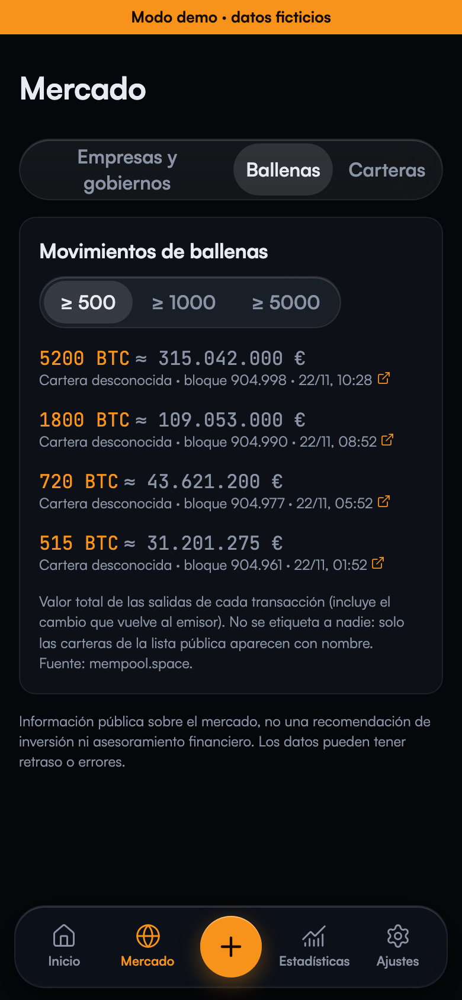
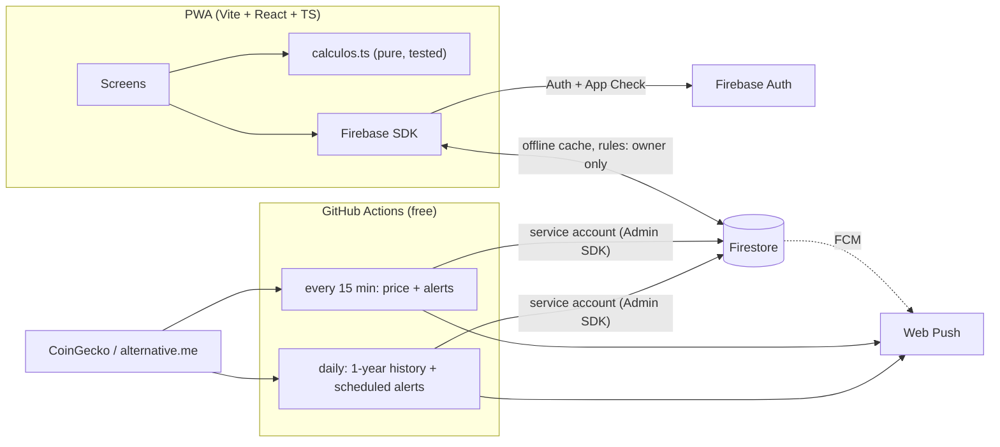
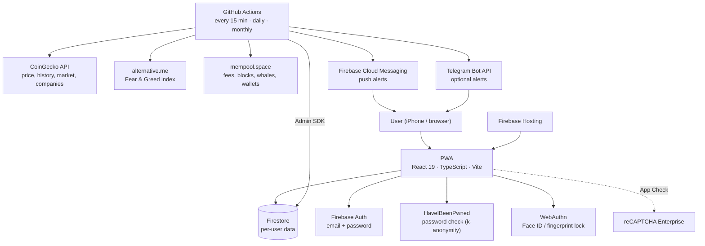

# Bitcoin Tracker

[](https://github.com/nelsongomezsa/bitcoin-tracker/actions/workflows/ci.yml)
[](LICENSE)

An installable web app (PWA) to manually track bitcoin purchases and sales: average price, current value, profit or loss, FIFO-based realised gains, charts, calculators and push alerts. Each user has a private account. Everything runs on **free tiers only** (Firebase Spark + GitHub Actions), with no credit card.

**Live demo:** https://bitcoin-tracker-4aac9.web.app (the login screen has a "Probar sin cuenta" button that loads a fictitious portfolio).

> **Resumen en español.** App instalable en el iPhone (Safari → «Añadir a pantalla de inicio») para apuntar a mano compras y ventas de bitcoin. Calcula precio medio, valor, ganancia y rentabilidad, ventas por FIFO (criterio de Hacienda), calculadoras, objetivos y avisos push. Cada usuario tiene su cuenta y sus datos son privados gracias a las reglas de Firestore. Todo en el plan gratuito, sin tarjeta. Los avisos son información, nunca recomendaciones de inversión. Las secciones «Cómo ejecutarla», «Despliegue» y «Secretos» explican cómo ponerla en marcha.

## Screenshots (demo mode, fictitious data)

| Home | Statistics | Market | Whales | Add purchase |
|---|---|---|---|---|
|  |  |  |  |  |

Desktop: [Home](docs/capturas/inicio-escritorio.png) · [Market](docs/capturas/mercado-escritorio.png) · [Statistics](docs/capturas/estadisticas-escritorio.png) · [Settings](docs/capturas/ajustes-escritorio.png)

## Features

- Manual purchases and sales with live preview (BTC received, fee %, new average price, FIFO result before confirming).
- Average price with and without fees, "profitable from", gain per purchase, fee warning above 3 %.
- **FIFO** sales, realised gains, yearly FIFO report (CSV) and selling more than you own is rejected.
- EUR / USD / AUD display; every operation keeps its own currency.
- Price chart (lightweight-charts) with a marker per purchase/sale, average-price line and next key level.
- Statistics, plan with key levels and weekly DCA progress, goals with a sell-price target.
- Calculators: lower my average, "what if BTC reaches X", "if I sell today" (with an indicative Spanish savings-tax estimate).
- Push alerts (key level, back in profit, 24 h / 7 d moves, extreme fear, DCA reminder, monthly summary, backup reminder, sell target).
- Excel/CSV import with preview (client side, 2 MB max, real file-type check), CSV/XLSX export.
- **Alert settings**: ~35 alerts in 7 groups (price moves, new highs/lows, round numbers, break-even, profit milestones, key levels, DCA reminders, fear & greed zones, halving, summaries, whales, new-device login…), custom price alerts, per-alert priority and channel, quiet hours, daily limit, pause, alert history and push/Telegram delivery.
- **Market tab**: companies and governments holding BTC, whale movements (≥ 500 BTC) and public wallets you can follow. Stats: candlesticks, fear & greed gauge, dominance, halving cycle, network fees, drawdown, buy-price map, DCA calendar, fees per platform.
- Optional Face ID / fingerprint lock (WebAuthn), privacy mode, offline support, demo mode.

## Architecture



The client never calls CoinGecko: the jobs write `mercado/precio` and `mercado/historico`, and clients only read them (writes from clients are denied by the rules). To save free-tier reads, the client leaves a small summary (in EUR) in `users/{uid}/avisos/config` so the job reads one document per user instead of all their operations.

## Stack, APIs and services at a glance

A quick map of everything the project uses, so anyone (or a future project) can see the pieces at a glance.



### External APIs and services

| Service | Used for | Called from | Cost |
|---|---|---|---|
| **CoinGecko API** (`/coins/markets`, `/coins/bitcoin/market_chart`, `/global`, public treasuries) | BTC price in EUR/USD/AUD, 1-year history, dominance, companies and governments holding BTC | GitHub Actions jobs only (never the browser) | Free (optional free *Demo* key) |
| **alternative.me** (`/fng`) | Fear & Greed index | GitHub Actions | Free, no key |
| **mempool.space** (`/v1/fees/recommended`, `/blocks/tip/height`, `/address/…`) | Network fees, halving countdown, whale movements, followed public wallets | GitHub Actions | Free, no key |
| **Firebase Authentication** | Accounts, email verification | Browser | Spark (free) |
| **Cloud Firestore** | Each user's purchases, sales, goals and alert settings; shared market data | Browser (rules: owner only) and jobs (Admin SDK) | Spark (free) |
| **Firebase Cloud Messaging** | Web push alerts on iPhone and desktop | Jobs send, service worker receives | Free |
| **Firebase Hosting** | Serves the PWA with security headers | — | Spark (free) |
| **Firebase App Check + reCAPTCHA Enterprise** | Blocks requests that don't come from the real app | Browser | Free tier |
| **Telegram Bot API** | Optional alerts to a Telegram chat | GitHub Actions | Free |
| **HaveIBeenPwned (Pwned Passwords)** | Rejects leaked passwords at sign-up; only 5 hash characters leave the device | Browser | Free, no key |
| **GitHub Actions** | Scheduled jobs (price + alerts every 15 min, daily history, monthly keep-alive) and CI | — | Free on public repos |

### Main libraries

| Area | Libraries |
|---|---|
| UI | React, React Router, Motion (animations), lucide-react (icons) |
| Charts | lightweight-charts (price chart with markers), Recharts (statistics) |
| Data and validation | Zod (forms mirrored by Firestore rules), SheetJS `xlsx` (Excel/CSV import and export) |
| PWA | vite-plugin-pwa, Workbox |
| Backend jobs | firebase-admin (Node scripts in `jobs/`) |
| Testing | Vitest, fast-check (property tests), decimal.js (independent exact calculator), `@firebase/rules-unit-testing` (Firestore rules), jsdom |
| Quality | TypeScript, ESLint, gitleaks |

## Optional integrations (free)

- **Telegram alerts.** Create a bot with @BotFather, then `gh secret set TELEGRAM_BOT_TOKEN --repo <you>/bitcoin-tracker` (paste the token when prompted, never in a chat) and put the bot username in `VITE_TELEGRAM_BOT`. Users link their chat from the Alerts screen with a one-time 15-minute code. Without the secret the job simply skips Telegram.
- **Companies and governments holding BTC.** Get a free CoinGecko *Demo* API key (https://www.coingecko.com/en/api) and run `gh secret set COINGECKO_DEMO_KEY --repo <you>/bitcoin-tracker`. Without it that section stays empty. The response parsing is tolerant, but it has not been checked against the live API.
- **Public wallets.** `config/carteras.json` ships empty on purpose: add only addresses that an entity publishes itself, each with a source link. No private individuals.
- **Fonts.** The display font Satoshi (Fontshare Free Font License) may be self-hosted but not redistributed, so `public/fonts/Satoshi-Variable.woff2` is git-ignored. Download it from Fontshare into that folder (see `public/fonts/LEEME.md`); without it the system font is used.

## Free-tier budget

Per user and run the alert job reads 3 documents (`config`, `estado`, `prueba`) in one collection-group query, plus a few shared market documents per run. At every 15 minutes that is about 96 × 3 = 288 reads per user per day plus ~600 shared reads, so the 50,000 reads/day budget supports roughly 150 users with alerts enabled. Writes are 1 (state) + 1 per alert delivered per run, only when something changes.

## Technical decisions

- **Calculations are pure and tested** (`src/lib/calculos.ts`). Public tests use invented data with hand-computed expectations (10 fake purchases, same-day purchases, partial FIFO sale, over-selling, 2 bought + 2 pending levels, 1 %/week DCA over 25 weeks). An optional private test compares real spreadsheet results against `datos-privados/esperado.json` and is skipped when those files are absent.
- **FIFO**: sales consume the oldest lots first; a sale yields `BTC = (received + fee) / price` and a realised gain over the lot cost (fees included). Average price and invested capital are computed over what remains.
- **Firestore rules** validate type, range and shape of every field (`keys().hasOnly`, amount > 0 and < 10 M, fee ≥ 0 and < amount, price > 0, not-future date, note ≤ 200 chars) and tie everything to `users/{uid}`. 20 emulator tests cover IDOR, mass assignment and validation.
- **Push on iOS** only works from the installed PWA and after a user gesture, so the permission is requested from a button, never automatically. The service worker handles the raw FCM push payload.
- **Free tier**: Firestore reads are kept low (snapshot listeners with persistent cache, one-document-per-user alert summary). GitHub Actions replaces Cloud Functions/Scheduler.

## Security

1. No secrets in git: `.env` ignored, `.env.example` without values, gitleaks as pre-commit hook and scanned before every push.
2. Only the public Firebase config is in the client; the service-account key lives in GitHub Secrets and is used only by scheduled jobs (`permissions: contents: read`, pinned action SHAs, never on `pull_request`).
3. Firestore rules: owner-only access on every collection, verified email required, everything else denied; `mercado/*` read-only for clients.
4. Server-side validation in the rules, mirrored client-side with Zod.
5. Firebase Auth rate limiting stays on; App Check with reCAPTCHA Enterprise is wired in (set `VITE_RECAPTCHA_SITE_KEY` and enforce it in the console).
6. No string-built queries (SDK only), no `dangerouslySetInnerHTML` (ESLint rule forbids it).
7. Passwords handled by Firebase Auth; minimum 10 characters, checked against HaveIBeenPwned with k-anonymity (only 5 hash characters leave the device).
8. Default Firebase token persistence (IndexedDB); nothing is copied to `localStorage` except the public WebAuthn credential id for the optional lock.
9. Email verification required (enforced in the UI and in the rules).
10. Generic error messages for users; details only in the dev console. Job logs never print user data or tokens.
11. Dependabot enabled; `npm audit` before each phase. Known: `npm audit` reports `@grpc/grpc-js` via `firebase`. That package is only used by Node entry points and is **not** in the browser bundle; the suggested "fix" is a downgrade to firebase 9, so it is intentionally not applied.
12. Import: real file-type check (magic bytes), 2 MB cap, 500 rows, processed in the browser; export neutralises spreadsheet formula injection.
13. Hosting headers: CSP, `X-Frame-Options`, `nosniff`, referrer and permissions policies.
14. 2FA (TOTP) is implemented but disabled: Firebase only offers it with Identity Platform, which requires billing. Set `VITE_ENABLE_MFA=true` after enabling it in your project.

## Run locally

```bash
npm install
cp .env.example .env            # fill in your Firebase web config (or leave empty and use the demo)
npm run dev                     # http://localhost:5173
npm test                        # unit tests (Vitest)
npm run test:rules              # Firestore rules against the local emulator (needs Java 21+)
npm run lint && npm run build
```

To run the app against the emulators set `VITE_USE_EMULATOR=true`, then `npx firebase emulators:start --only auth,firestore --project demo-bitcoin-tracker`.

## Deploy (Firebase Spark plan, no card)

1. Create a Firebase project and keep the **Spark** plan. Enable **Authentication → Email/Password**, **Firestore** (region `eur3` or `europe-west1`) and **Cloud Messaging**.
2. Copy `.firebaserc.example` to `.firebaserc` with your project id; fill `.env` from *Project settings → Your apps → Web app*, and the Web Push key (VAPID) into `VITE_FIREBASE_VAPID_KEY`.
3. In Authentication → Settings → Authorized domains keep only your Hosting domain and `localhost`.
4. Create a reCAPTCHA Enterprise key, register it in App Check, set `VITE_RECAPTCHA_SITE_KEY` and enforce App Check for Firestore.
5. Deploy:

```bash
npm run build
npx firebase login
npx firebase deploy --only hosting,firestore
```

## Service account and GitHub Secrets (step by step)

1. Firebase console → Project settings → **Service accounts** → *Generate new private key*. A JSON file downloads.
2. In your GitHub repo: *Settings → Secrets and variables → Actions → New repository secret*. Name: `FIREBASE_SERVICE_ACCOUNT`. Value: paste the whole JSON.
3. Delete the downloaded JSON from your machine (it is also git-ignored).
4. In the *Actions* tab run **Mercado** and **Diario** once with *Run workflow* to check them.

Notes on scheduled jobs: GitHub may delay `schedule` runs by several minutes, and it **disables scheduled workflows after 60 days without repository activity**. The monthly `Mantenimiento` workflow makes an empty commit to keep them alive; if they are ever disabled, re-enable them from the Actions tab. The repo must be public for the minutes to be free.

## Install on iPhone

Open the site in **Safari** → Share → **Add to Home Screen**. Open the app from the new icon; notifications can only be enabled from there.

Everything works on the free **Spark** plan: no Blaze, no Cloud Functions, no card.

## Disclaimer

Alerts and calculators are information, not investment, financial or tax advice.

## License

MIT
